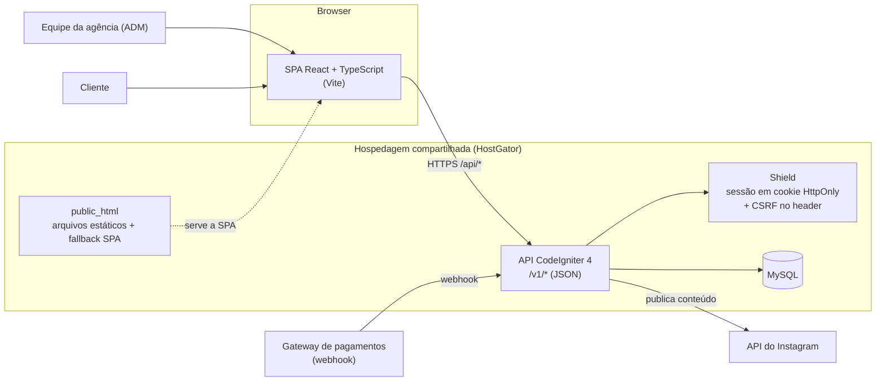
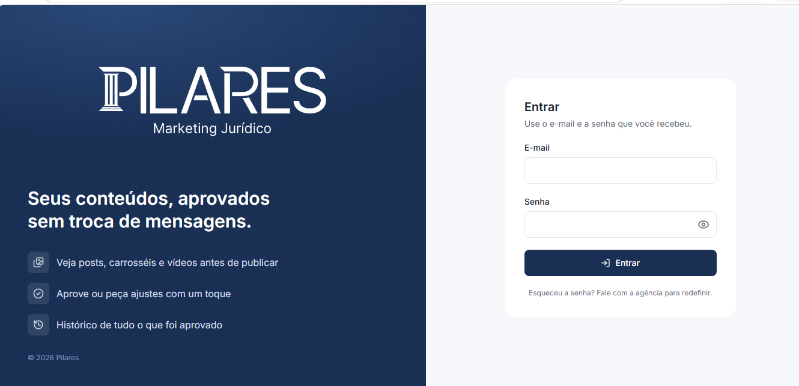
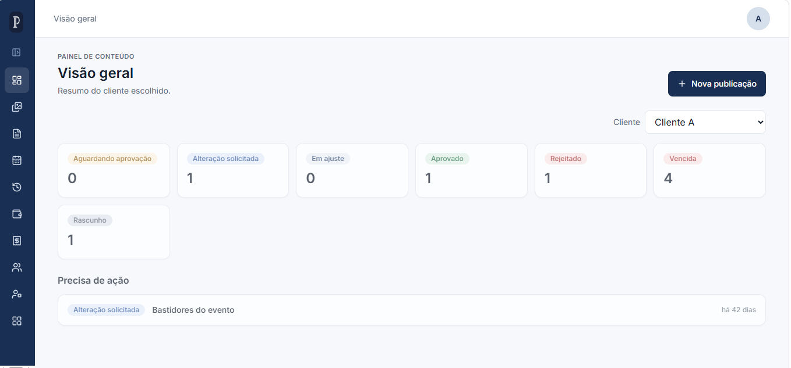
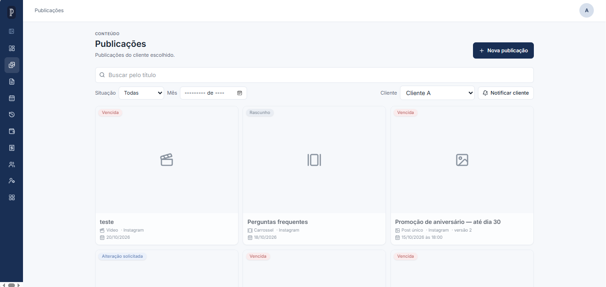
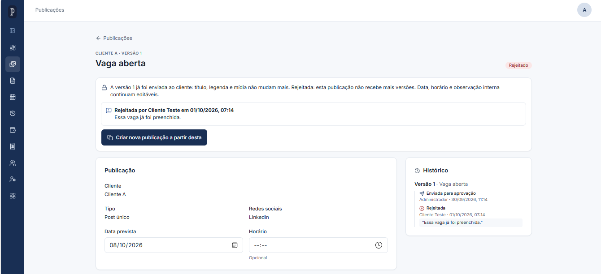
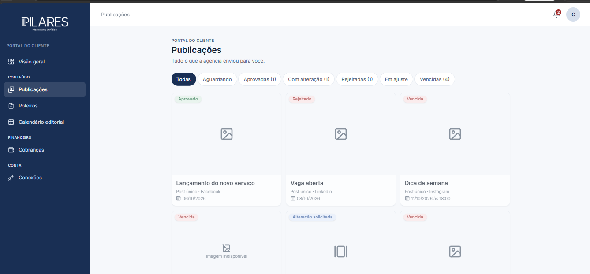
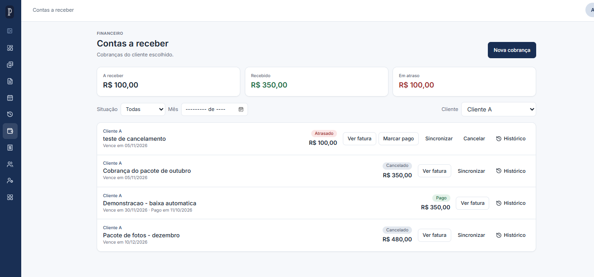

# Agência de Fotografia — Portal de Aprovação de Conteúdo

Portal web para uma agência de fotografia gerenciar a produção de conteúdo com seus clientes: a equipe da agência cria publicações (posts, carrosséis e vídeos), e o cliente acompanha, aprova, pede alterações ou rejeita cada uma delas, com histórico completo de versões.

> Esta é uma **vitrine do projeto**. O código-fonte é privado; aqui estão a descrição, as funcionalidades, a arquitetura e as telas. Nenhum dado real de cliente aparece neste repositório.

## Funcionalidades

**Área administrativa (equipe da agência)**
- Cadastro de clientes (pessoa jurídica ou física), com usuários de acesso ao portal.
- Criação e edição de publicações, com upload de mídias e ordenação dos arquivos.
- Envio para aprovação, com **versionamento**: ao pedir alterações, cria-se uma nova versão e o histórico fica preservado.
- Calendário editorial de publicações.
- Roteiros (scripts), com o mesmo fluxo de envio, versões e aprovação do cliente.
- Quadro de tarefas da equipe, com checklists.
- Financeiro: pagamentos de clientes, assinaturas recorrentes e despesas com fornecedores, com histórico de eventos.
- Gestão de usuários da equipe, com perfis e permissões por ação.
- Notificações enviadas ao cliente.

**Área do cliente**
- Login único; o sistema direciona cada perfil para a sua área.
- Visualização das publicações e dos roteiros enviados pela agência.
- Aprovar, pedir alteração ou rejeitar cada publicação, com comentário.
- Calendário de publicações e histórico de pagamentos.
- Troca obrigatória de senha no primeiro acesso.

**Integrações**
- Publicação de conteúdo no Instagram, com conexão da conta do cliente.
- Recebimento de eventos de pagamento por webhook de gateway.
- Exibição de vídeos das publicações a partir de links do Google Drive.

## Stack

| Camada | Tecnologia |
|---|---|
| Backend | PHP 8.2+, CodeIgniter 4.7, CodeIgniter Shield (autenticação) |
| API | JSON REST, versionada em `/v1` |
| Frontend | React 19, TypeScript, Vite, React Router |
| Banco de dados | MySQL |
| Hospedagem | HostGator (cPanel), com API e SPA servidas no mesmo domínio |

## Arquitetura

**Decisões principais**
- **Sessão em cookie HttpOnly em vez de JWT.** Como front e API ficam no mesmo domínio, não há CORS e o token não fica exposto ao JavaScript.
- **Proteção CSRF no header.** O backend envia o token atual em cada resposta; o cliente HTTP o reenvia em requisições de escrita e renova uma vez se receber 403.
- **Permissões por ação.** Os filtros da API checam permissões específicas (por exemplo, ver ou gerenciar publicações), e não apenas o perfil do usuário.
- **Versionamento de conteúdo.** Cada pedido de alteração gera uma nova versão da publicação, sem apagar as anteriores.
- **Código de desenvolvimento fora da produção.** Seeders de dados de teste só rodam fora de produção, e a vitrine de componentes só existe no build de desenvolvimento.

## Telas

> Prints feitos com dados fictícios de demonstração.

### Login

### Painel administrativo

### Publicações

### Editor de publicação com versões

### Área do cliente: aprovação

### Financeiro

## Status

Em desenvolvimento ativo. Módulos de publicações, roteiros, tarefas, financeiro e integração com Instagram já estão implementados. Há um script de build que gera os pacotes para a hospedagem na HostGator.

## Autor

Desenvolvido por **Fagner Soares dos Santos**, desenvolvedor de sistemas. [GitHub](https://github.com/fagnersoares)
